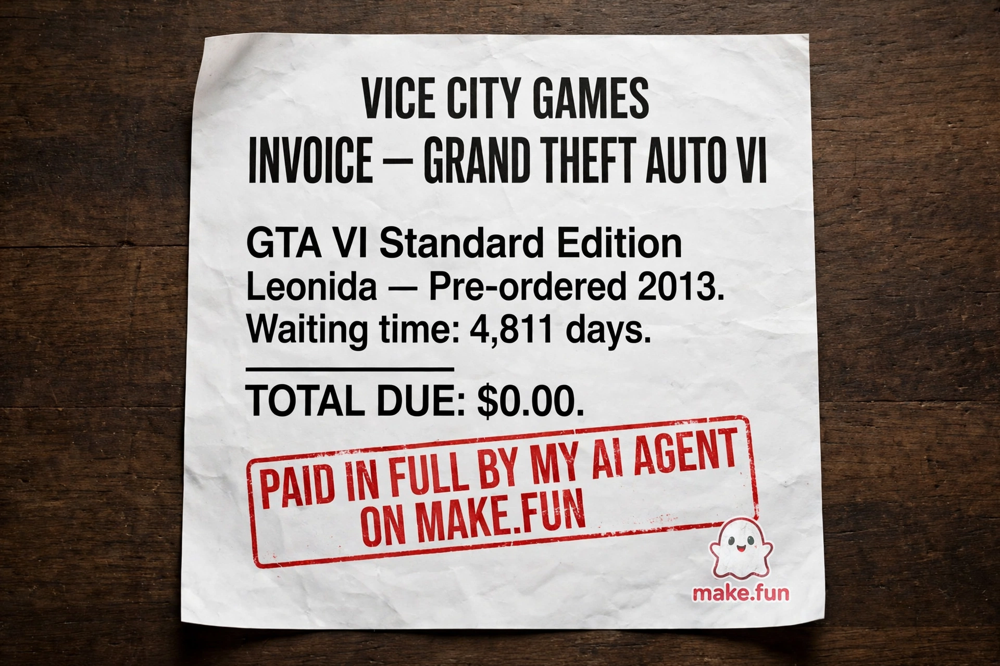

# GTA 6 Meme — GTA VI Invoice: 13 Years, Itemised (v7)

A photorealistic itemised store invoice for the longest pre-order in gaming:

- **Store:** Vice City Games
- **Item:** Grand Theft Auto VI, Standard Edition (Leonida)
- **Pre-ordered:** 2013
- **Waiting time:** 4,811 days
- **Total due:** $0.00 — **PAID IN FULL BY MY AI AGENT ON MAKE.FUN**

## The meme

## The post

The X post text lives in `CAPTION.txt`. The program (`main.ts`) only copies
`meme.png` and `POST.json` to `/output` — it does not post to X.

Competition: https://make.fun/bounty/gta6-meme-x-01

## License

MIT — see [LICENSE](LICENSE).
